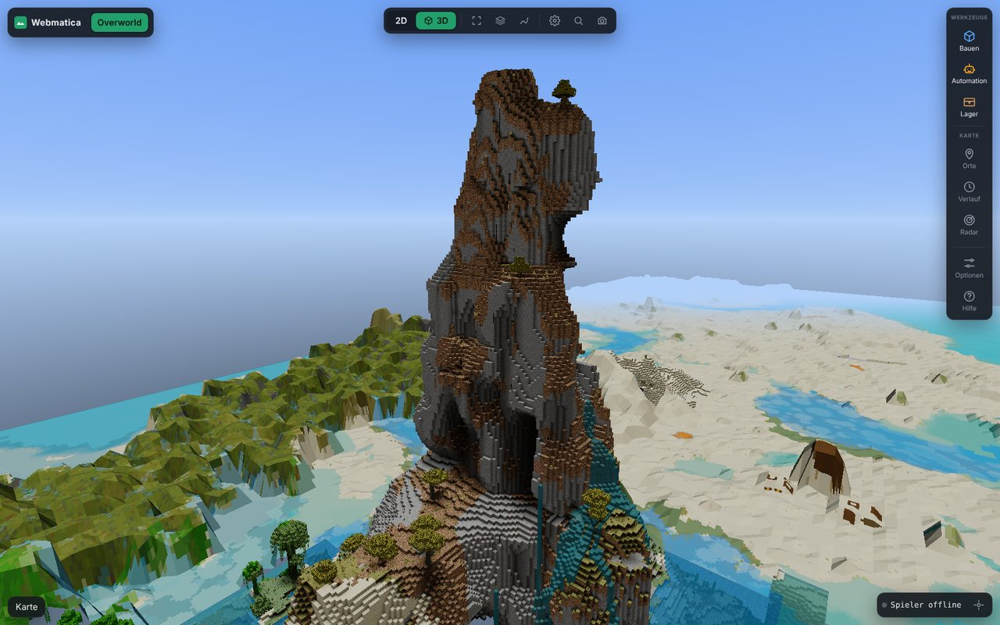
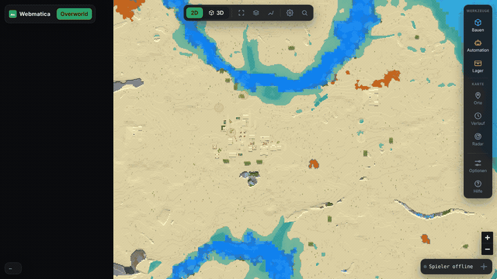
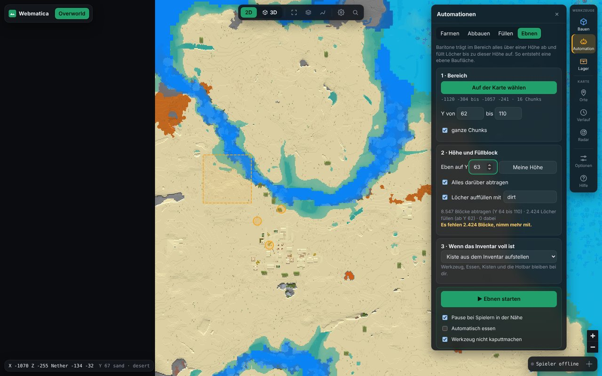

# Webmatica

[English](README.md) · **Deutsch**

Deine Minecraft-Welt im Browser: Karte, 3D-Ansicht, Kisten und Schematics, dazu Litematica und
Baritone fernsteuern. Läuft auf jedem Server und im Singleplayer.


- **Mod** (Fabric 1.21.11, nur Client): speichert jeden Chunk, den du siehst, als normale
  Regiondateien und merkt sich Kisteninhalte. Schickt nichts an den Server oder in den Chat.
- **Viewer** (Python, läuft lokal unter <http://127.0.0.1:8770>): alles Folgende im Browser.
  Auf Deutsch und Englisch (Umschalter unter Optionen).

## Funktionen

| | |
|---|---|
|  |  |
|  |  |
|  |  |
|  |  |

- **Karte und 3D** von allem, was du gesehen hast, mit echten Blockmodellen, weichem Licht,
  Schatten und Fernsicht bis 65.000 Blöcke. Live-Position, Spur, Verfolger-Kamera und Mob-Spawns.
- **Schematic-Editor:** Blöcke setzen, abbauen und füllen, alle Blöcke einer Sorte ersetzen oder
  löschen, kopieren, verschieben, drehen, mit Rückgängig. Jeder Bereich deiner Welt wird mit zwei
  Klicks zur Schematic.
- **Schematics:** `.litematic`, `.schem` oder `.nbt` laden, auf der Karte platzieren, mit einem
  Klick an Litematica schicken und sehen, welche Items noch fehlen. Inventar und Kisten sind schon
  abgezogen.
- **Automation mit Baritone:** bestimmte Blöcke farmen, einen Bereich abbauen, füllen oder ebnen
  oder eine ganze Schematic bauen. Material kommt aus deinen Kisten, Reste gehen zurück, und er hält
  an, wenn ein Spieler in die Nähe kommt. Eine Warteschlange baut mehrere Schematics nacheinander.
- **Lager:** Jede Kiste, die du öffnest, wird gemerkt, auch der Inhalt von Shulkern. Such ein Item
  über alle Kisten, lass Baritone genau die gewählten Stacks holen oder dein Inventar dorthin
  einlagern, wo das Item schon liegt. Mit Stash-Finder.
- **Außerdem:** Wegpunkte, Schilder, Zeitleiste der Änderungen, Radar für Spieler in der Nähe, Suche
  nach Koordinaten oder Wegpunkten.

## Voraussetzungen

- Minecraft 1.21.11 mit Fabric Loader und Fabric API
- Python 3.10+ (Windows: „Add python.exe to PATH“ anhaken)
- Optional: [Baritone](https://github.com/cabaletta/baritone), [Litematica](https://modrinth.com/mod/litematica) + [MaLiLib](https://modrinth.com/mod/malilib), Litematica Printer

## Installation

1. `webmatica-<version>.jar` von den [Releases](https://github.com/Ehnkode/webmatica/releases)
   in den `mods`-Ordner legen.
2. Minecraft einmal mit der Mod starten.
3. Dieses Repository herunterladen (Code → Download ZIP), entpacken und `start-viewer.bat`
   starten (Linux/macOS: `./start-viewer.sh`). Der erste Start dauert etwa eine Minute.

**F9** im Spiel schaltet die Aufnahme an und aus. **?** im Viewer zeigt alle Tastenkürzel.

## Mod bauen

```bash
./gradlew build    # Jar in build/libs/
```

## Hinweise

Automatisierung ist nicht auf jedem Server erlaubt, Nutzung auf eigenes Risiko. Aufnahmen verraten
Koordinaten, also nicht teilen.

MIT-Lizenz, siehe [LICENSE](LICENSE).
