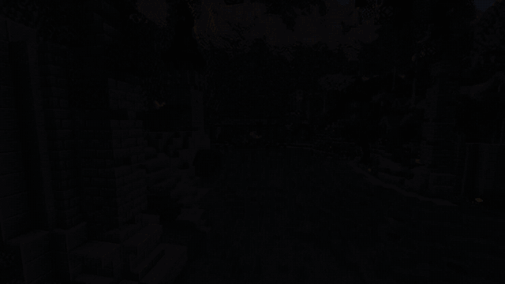
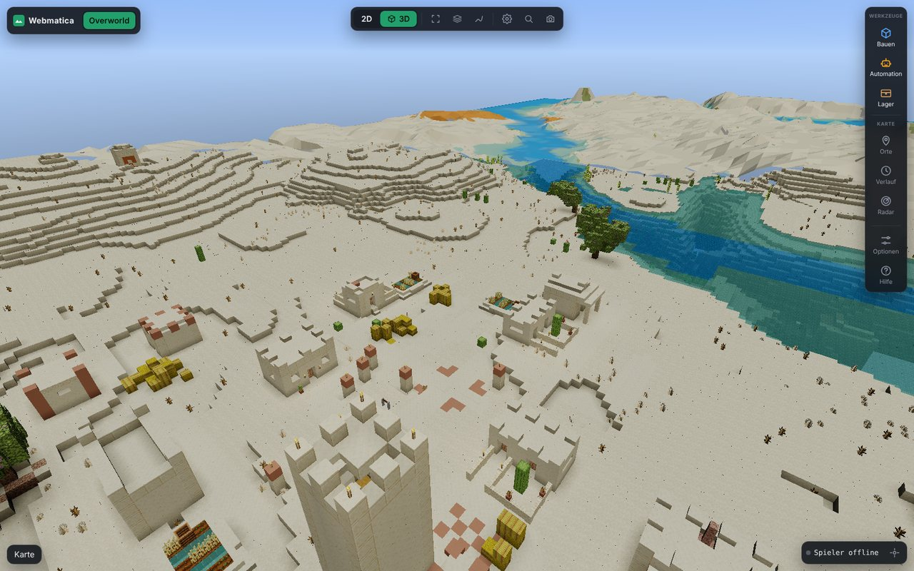

# Webmatica

[English](README.md) · **Deutsch**

Deine Minecraft-Welt im Browser: Karte, 3D-Ansicht, Kisten und Schematics, dazu Litematica und
Baritone fernsteuern. Läuft auf jedem Server und im Singleplayer.



- **Mod** (Fabric, Minecraft 1.21.11 bis 26.3, nur Client): speichert jeden Chunk, den du siehst, als normale
  Regiondateien und merkt sich Kisteninhalte. Schickt nichts an den Server oder in den Chat.
- **Viewer** (Python, läuft lokal unter <http://127.0.0.1:8770>): alles Folgende im Browser.
  Auf Deutsch und Englisch (Umschalter unter Optionen).

## Funktionen

| | |
|---|---|
|  |  |
|  |  |
|  |  |

- **Karte und 3D** von allem, was du gesehen hast, mit echten Blockmodellen, weichem Licht,
  Schatten und Fernsicht bis 65.000 Blöcke. Live-Position, Spur, Verfolger-Kamera und Mob-Spawns.
- **Schematic-Editor:** Blöcke setzen, abbauen und füllen, alle Blöcke einer Sorte ersetzen oder
  löschen, kopieren, verschieben, drehen, mit Rückgängig. Jeder Bereich deiner Welt wird mit zwei
  Klicks zur Schematic.
- **Schematics:** `.litematic`, `.schem` oder `.nbt` laden, auf der Karte platzieren, mit einem
  Klick an Litematica schicken und sehen, welche Items noch fehlen. Inventar und Kisten sind schon
  abgezogen.
- **Automation mit Baritone:** bestimmte Blöcke farmen, einen Bereich abbauen, füllen oder ebnen
  oder eine ganze Schematic bauen. Material kommt aus deinen Kisten, Reste gehen zurück, und er hält
  an, wenn ein Spieler in die Nähe kommt. Eine Warteschlange baut mehrere Schematics nacheinander.
- **Lager:** Jede Kiste, die du öffnest, wird gemerkt, auch der Inhalt von Shulkern. Such ein Item
  über alle Kisten, lass Baritone genau die gewählten Stacks holen oder dein Inventar dorthin
  einlagern, wo das Item schon liegt. Mit Stash-Finder.
- **Außerdem:** Wegpunkte, Schilder, Zeitleiste der Änderungen, Radar für Spieler in der Nähe, Suche
  nach Koordinaten oder Wegpunkten.

## Voraussetzungen

- Minecraft 1.21.11, 26.1, 26.2 oder 26.3 mit Fabric Loader und Fabric API
- Python 3.10+
- Optional: [Baritone](https://github.com/cabaletta/baritone), [Litematica](https://modrinth.com/mod/litematica) + [MaLiLib](https://modrinth.com/mod/malilib), Litematica Printer

## Installation

1. Die Jar für deine Minecraft-Version (`webmatica-<version>+mc<minecraft>.jar`) von Modrinth oder den
   [Releases](https://github.com/Ehnkode/webmatica/releases) in den `mods`-Ordner legen.
2. Minecraft starten und **F10** drücken. Der Viewer startet und öffnet sich im Browser. Der erste
   Start dauert etwa eine Minute (er installiert numpy und Pillow und erzeugt die Blockbilder).

Der Viewer steckt in der Mod und liegt danach in `<Spielordner>/webmatica-viewer/`. Er endet, wenn
du das Spiel schließt. Ohne Spiel startest du ihn mit `start-viewer.bat` in diesem Ordner
(Linux/macOS: `./start-viewer.sh`).

**F9** im Spiel schaltet die Aufnahme an und aus, **F10** öffnet den Viewer. **?** im Viewer zeigt alle Tastenkürzel.

## Mod bauen

```bash
./gradlew buildAll    # eine Jar pro Minecraft-Version in build/libs/
```

## Wie es entsteht

Webmatica entsteht mit KI-Unterstützung (Claude). Ideen, Richtung, Tests im Spiel und alle Entscheidungen kommen von mir, beim Schreiben von Code und Texten hilft die KI.

## Hinweise

Automatisierung ist nicht auf jedem Server erlaubt, Nutzung auf eigenes Risiko. Aufnahmen verraten
Koordinaten, also nicht teilen.

MIT-Lizenz, siehe [LICENSE](LICENSE).
