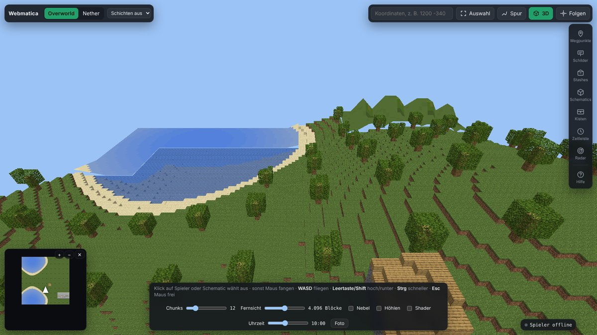

# Webmatica

Deine Minecraft-Welt im Browser: Karte, 3D, Kisten und Schematics, dazu Litematica und Baritone
fernsteuern. Ursprünglich für 2b2t gebaut, läuft aber auf jedem Server und im Einzelspieler.

**English summary:** A client-side Fabric mod for Minecraft 1.21.11 that saves every chunk your
client receives as normal region files, plus a local browser viewer: 2D map, 3D view with real block
models, chests and their contents, a schematic library and editor, and helpers for Litematica and
Baritone (fetch materials from your chests, build automatically). Everything runs on your own PC.
The interface is in German.

---



Zwei Teile, die zusammenarbeiten:

1. **Mod** (Fabric, nur Client): speichert jeden Chunk, den dein Client vom Server bekommt, als
   normale Minecraft-Regiondateien, getrennt nach Server und Dimension. Abgebaute und gesetzte
   Blöcke und Kisteninhalte werden nachgezogen. Die Mod schickt nichts an den Server und nichts in
   den Chat.
2. **Viewer** (Python, läuft lokal im Browser unter <http://127.0.0.1:8770>): Karte, 3D-Ansicht,
   Kisten, Schematics und die Steuerung für Baritone, Litematica und den Printer.

## Was es kann

- **Karte:** Vollbild-Karte aller aufgenommenen Chunks mit Höhenschatten, Schnitthöhe, Overworld,
  Nether und End, Live-Position mit Skin und Spur.
- **3D:** echte Minecraft-Blockmodelle, Fernsicht, Minimap, Kamera hinter dem Spieler oder frei.
- **Seitenleiste:** Wegpunkte, Schilder, Stash-Finder, Kisten (Inhalte, Suche über alle Kisten),
  Zeitleiste (was hat sich seit einem Tag geändert) und Radar (andere Spieler in Sichtweite, auch
  wer in deiner Nähe Kisten öffnet).
- **Schematics:** Bibliothek (Litematica-Ordner und Uploads), auf der Karte platzieren, drehen,
  spiegeln, Materialliste mit fehlenden Items, Abgleich mit der Welt (was fehlt, was falsch
  steht), „Ins Spiel“ schickt die Platzierung an Litematica.
- **Editor:** Blöcke setzen und abbauen, Bereiche füllen, Wände, Kopieren, Drehen, alle Blöcke einer
  Sorte ersetzen oder löschen, Rückgängig, Speichern/Verwerfen. Aus einem Ausschnitt der Welt
  lässt sich direkt eine Schematic machen.
- **Baritone:** Hinlaufen per Klick, Items aus einer Kiste holen, Inventar in passende Kisten
  einlagern, Shulker auspacken.
- **Autobau:** holt fehlendes Material aus deinen Kisten und baut die Schematic mit Baritone, bis
  sie steht. Optional: Pause, wenn ein Spieler kommt; automatisch essen; Werkzeug schonen; Reste
  zurück in die Kisten bringen.

## Voraussetzungen

| Was | Wofür |
|---|---|
| Minecraft **1.21.11** mit **Fabric Loader** 0.19+ und **Fabric API** | Pflicht |
| **Python 3.10+** (Windows: beim Installieren „Add python.exe to PATH“ anhaken) | Viewer |
| [Baritone](https://github.com/cabaletta/baritone) (Fabric-Version für 1.21.11) | Hinlaufen, Holen, Einlagern, Autobau |
| [Litematica](https://modrinth.com/mod/litematica) und optional Litematica Printer | „Ins Spiel“, Schichten, Printer |

Ohne Baritone und Litematica laufen Aufnahme, Karte, 3D, Kisten und Editor trotzdem.

## Installation

1. **Mod:** `webmatica-<version>.jar` von der [Releases-Seite](https://github.com/Ehnkode/webmatica/releases) (oder selbst bauen, siehe unten)
   zusammen mit der Fabric API in den `mods`-Ordner deines Minecraft-Profils legen.
2. **Minecraft einmal starten.** Die Mod merkt sich dabei in
   `<Benutzerordner>/.webmatica/client.json`, wo die Aufnahme liegt und wo die Spiel-Jar ist.
   Damit findet der Viewer alles selbst, egal welcher Launcher (Vanilla, Prism, MultiMC …).
3. **Viewer:** dieses Repository herunterladen (grüner Knopf „Code“ → „Download ZIP“) und entpacken.
   - Windows: `start-viewer.bat` doppelklicken.
   - Linux/macOS: `./start-viewer.sh`
   Beim ersten Start installiert das Skript `numpy` und `Pillow` und baut einmalig Blocktexturen und
   Item-Bilder aus deiner Minecraft-Jar (etwa eine Minute). Die gehören Mojang und liegen deshalb
   nicht im Repository. Danach öffnet sich der Browser.

Mehrere Profile? Der Viewer nimmt das, mit dem Minecraft zuletzt lief. Ein bestimmter Ordner:

```
start-viewer.bat --recording "D:\Pfad\zum\Profil\webmatica_recording"
```

Wurde die Minecraft-Jar nicht gefunden: `--jar "<.minecraft>/versions/1.21.11/1.21.11.jar"`.

## Bedienung

- **F9** im Spiel schaltet die Aufnahme an und aus (änderbar in der Steuerung).
- Im Viewer zeigt **?** alle Tastenkürzel. Die wichtigsten: **1–7** öffnen die Bereiche der
  Seitenleiste, **Tab** wechselt zwischen Karte und 3D, **/** springt zu Koordinaten, **E** wählt
  einen Bereich aus (für Schematic-Export, Editor, Freiräumen), Rechtsklick auf die Karte setzt
  Wegpunkte oder schickt Baritone hin.
- **Kisten:** Kisteninhalte kennt der Viewer erst, wenn du die Kiste im Spiel einmal geöffnet
  hast. Ab dann siehst du sie auf der Karte, in der Suche und in den Materiallisten.
- **Autobau:** Schematic anklicken → „Ins Spiel“ einschalten → Tab „Bauen“ →
  „Automatisch holen und bauen“. Unter „Schutz und Reste“ lässt sich jeder Schutz einzeln abschalten.

## Wo liegen die Daten?

Alles bleibt auf deinem Rechner:

```
<Minecraft-Profil>/webmatica_recording/
  <server>/region/, DIM-1/region/, DIM1/region/   aufgenommene Chunks (Minecraft-Format)
  .viewer/                                         Wegpunkte, Kisten, Platzierungen, Radar-Log …
  .viewer-cache/                                   Kartenkacheln (darf gelöscht werden)
<Benutzerordner>/.webmatica/client.json          wo Aufnahme und Spiel-Jar liegen
```

Die Regiondateien lassen sich auch mit MCA Selector, Amulet oder Chunky öffnen.

> **Achtung beim Teilen:** Aufnahmen, `.viewer/` und Screenshots verraten Koordinaten. Nichts davon
> gehört in ein Repository oder einen Issue-Bericht. Die `.gitignore` schließt diese Dateien aus.

## Hinweise

- Automatisierung (Baritone, Printer, Autobau) ist auf manchen Servern verboten. Prüfe die Regeln
  des Servers, auf dem du spielst. Nutzung auf eigenes Risiko.
- Der Viewer hört nur auf `127.0.0.1`, ist also nur auf deinem eigenen Rechner erreichbar.
- Einzige Verbindung nach außen: Schickt die Mod keinen Skin, holt der Viewer ihn einmal über
  den Spielernamen von `mc-heads.net`.
- Die Mod meldet Position, Inventar und andere Spieler in Sichtweite nur an den lokalen Viewer
  (`http://127.0.0.1:8770`). Läuft der Viewer nicht, passiert nichts. Andere Adresse:
  JVM-Argument `-Dwebmatica.positionUrl=http://host:port/api/position`.

## Mod selbst bauen

Java 21 oder neuer, Gradle kommt über den Wrapper mit:

```bash
./gradlew build          # Windows: gradlew.bat build
```

Die fertige Jar liegt in `build/libs/`. GitHub baut sie bei jedem Push automatisch (Actions,
Artefakt „webmatica-mod“). Wird auf GitHub ein Release veröffentlicht, hängt der Build die Jar
automatisch daran.

## Ohne Minecraft ausprobieren

```bash
pip install -r requirements.txt
python -m viewer.tests.make_world demo
python -m viewer --recording demo --jar "<.minecraft>/versions/1.21.11/1.21.11.jar"
```

## Aufbau

```
src/main/java/io/github/ehnkode/webmatica/     Fabric-Mod
  MapperClient                   Einstieg: Events, F9, Tick
  RecordingTarget, RegionStore   Server/Dimension -> Ordner, Chunks gebündelt schreiben
  ChunkSnapshot                  Chunk auf dem Client-Thread kopieren, NBT bauen
  PositionReporter, ClientInfo   Position/Inventar an den Viewer, client.json
  ContainerTracker, ChestLidTracker   Kisteninhalte, Kisten, die andere öffnen
  LitematicaBridge, BuildControl Platzierungen, Printer und Schichten
  BaritoneBridge, FetchTask, UnpackTask, BaritoneSafety, AutoGuard   Baritone-Aufträge
  mixin/                         Blockänderungen, Block-Entity-Updates, Block-Events
viewer/                          Python-Viewer
  server.py                      HTTP-Server und API
  core/                          NBT, Chunks, Regiondateien, Kacheln, Blockmodelle, 3D-Netze, Schematics
  placements.py, editor.py       Schematic-Bibliothek und Editor
  extras.py, autobuild.py        Kisten, Baritone-Befehle, Radar, Zeitleiste, Autobau
  firstrun.py                    findet Aufnahme und Minecraft-Jar, baut die Texturen
  static/                        Oberfläche (Leaflet, three.js)
  tools/                         Blocktexturen und Item-Bilder aus der Minecraft-Jar bauen
docs/                            Hintergrund (z. B. wie Kisten-Öffnen erkannt wird)
```

## Lizenz

MIT, siehe [LICENSE](LICENSE). Leaflet und three.js liegen mit ihren eigenen Lizenzen unter
`viewer/static/vendor/`. Kein offizielles Minecraft-Produkt, nicht von Mojang oder Microsoft
genehmigt. Nicht verbunden mit 2b2t, Litematica (maruohon) oder Baritone; der Name ist eine
Anlehnung an Litematica.
