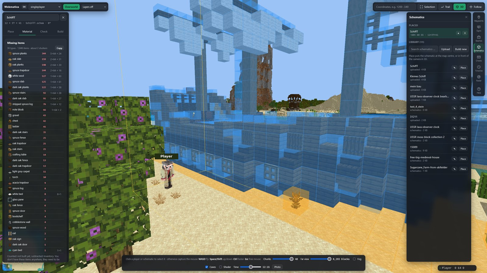
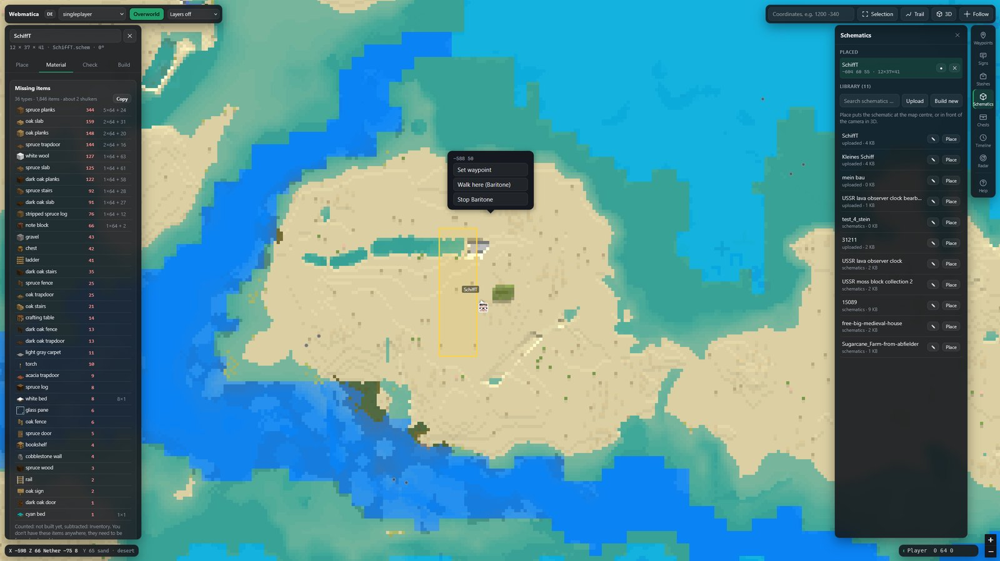
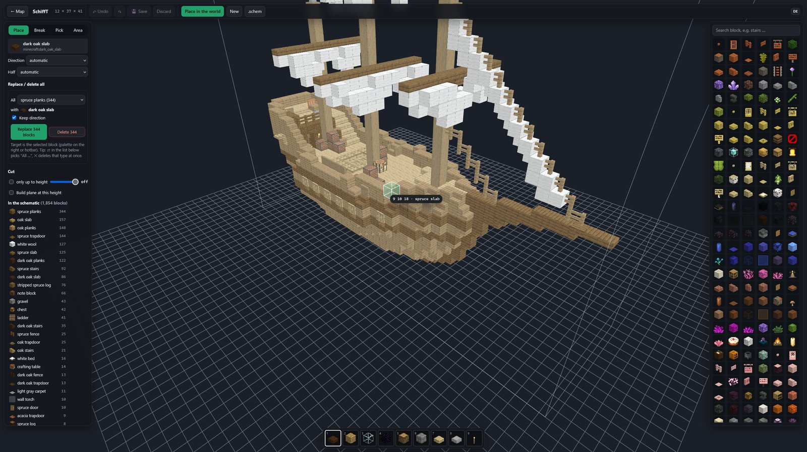
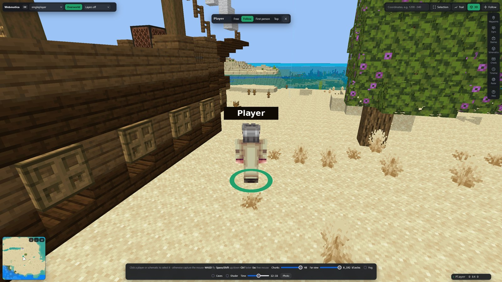

# Webmatica

**English** · [Deutsch](README.de.md)

Your Minecraft world in the browser: map, 3D view, chests and schematics, plus remote control for
Litematica and Baritone. Works on any server or Singleplayer.



- **Mod** (Fabric 1.21.11, client only): saves every chunk you see as normal region files and
  remembers chest contents. Sends nothing to the server or the chat.
- **Viewer** (Python, runs locally at <http://127.0.0.1:8770>): everything below, in your browser.
  English and German (switch at the top left).

## Features

| | |
|---|---|
|  |  |
|  | |

- **Map and 3D** of everything you have seen, with real block models, live position and trail.
- **Follow camera:** click yourself or another player in 3D and lock the camera on them, from
  behind, first person or from above.
- **Schematics:** load `.litematic`, `.schem` or `.nbt`, place them on the map, send them to
  Litematica with one click, and see which items are still missing. Your inventory and chests are
  already subtracted.
- **Schematic editor:** place, break and fill blocks, replace or delete every block of a type, copy,
  move and rotate, with undo. Any area of your world can become a schematic.
- **Chests:** every chest you open is remembered, shulker contents included. Search for an item
  across all chests, then let Baritone walk to the chest or fetch exactly the stacks you picked.
- **Goto:** right-click the map and pick "Walk here". Baritone walks there.
- **Auto build:** fetches the missing materials from your chests, builds with Baritone layer by
  layer, refills when it runs out and brings leftovers back. It pauses when a player comes close.
- **More:** waypoints, signs, stash finder, timeline of what changed, radar for nearby players.

## Requirements

- Minecraft 1.21.11 with Fabric Loader and Fabric API
- Python 3.10+ (Windows: tick "Add python.exe to PATH")
- Optional: [Baritone](https://github.com/cabaletta/baritone), [Litematica](https://modrinth.com/mod/litematica) + [MaLiLib](https://modrinth.com/mod/malilib), Litematica Printer

## Install

1. Put `webmatica-<version>.jar` from [Releases](https://github.com/Ehnkode/webmatica/releases)
   into your `mods` folder.
2. Start Minecraft once with the mod.
3. Download this repository (Code → Download ZIP), unzip it and run `start-viewer.bat`
   (Linux/macOS: `./start-viewer.sh`). The first start takes about a minute.

**F9** in game toggles recording. **?** in the viewer shows all shortcuts.

## Build the mod

```bash
./gradlew build    # jar in build/libs/
```

## Notes

Automation is not allowed on every server, use at your own risk. Recordings reveal coordinates,
don't share them.

MIT license, see [LICENSE](LICENSE).
