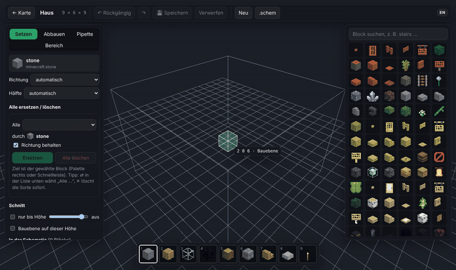
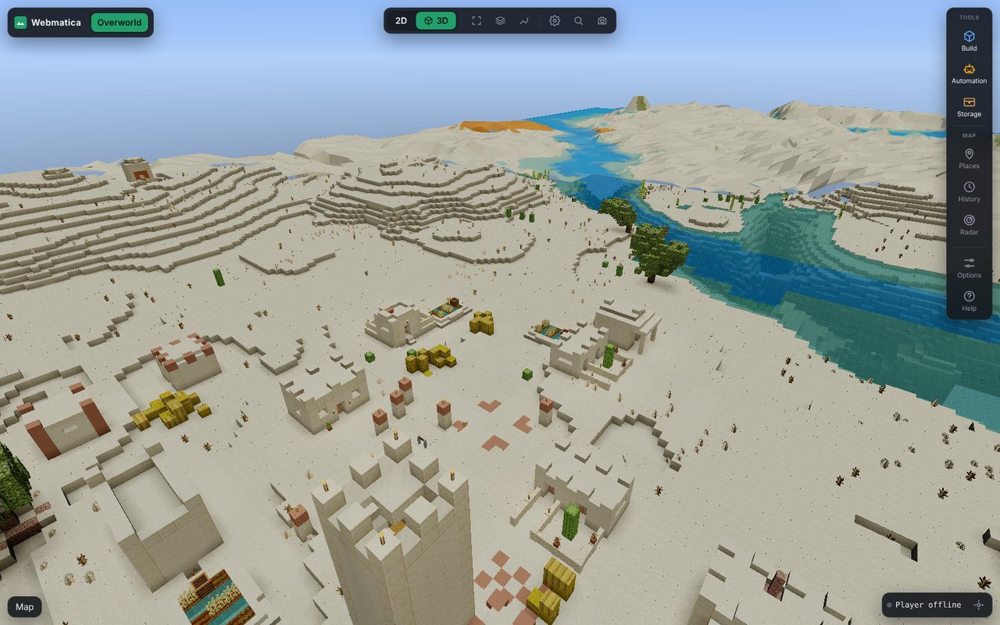
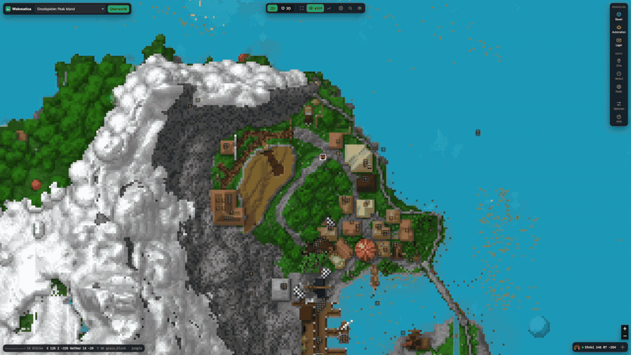
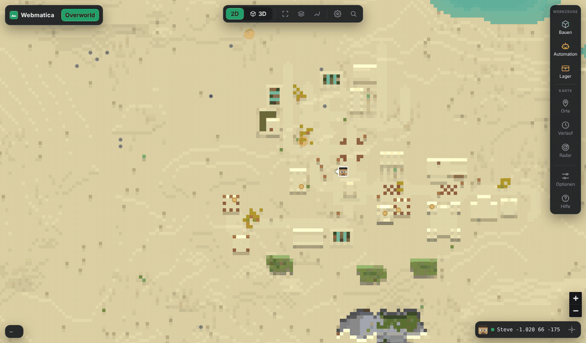
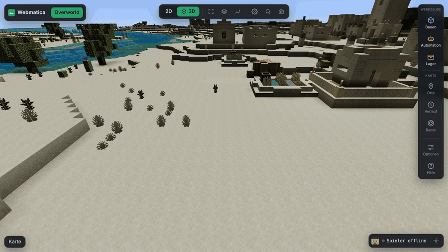
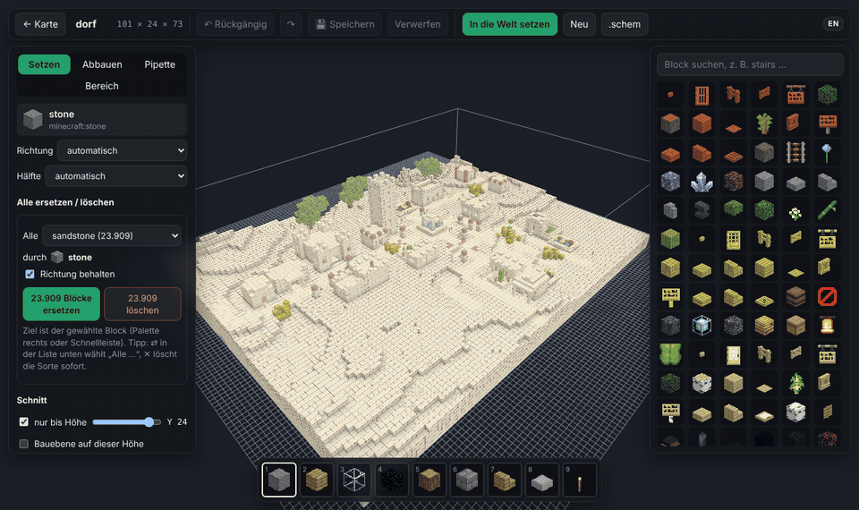
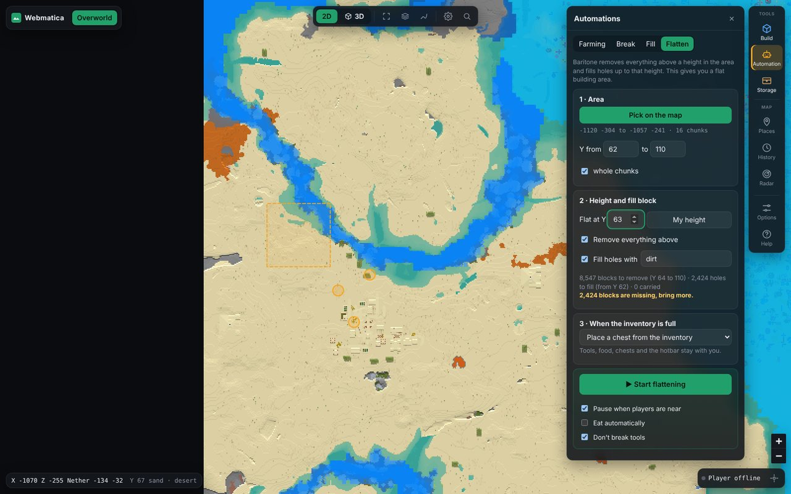

# Webmatica

**English** · [Deutsch](README.de.md)

Your Minecraft world in the browser: map, 3D view, chests and schematics, plus remote control for
Litematica and Baritone. Works on any server or Singleplayer.



- **Mod** (Fabric 1.21.11, client only): saves every chunk you see as normal region files and
  remembers chest contents. Sends nothing to the server or the chat.
- **Viewer** (Python, runs locally at <http://127.0.0.1:8770>): everything below, in your browser.
  English and German (switch under Options).

## Features

| | |
|---|---|
|  |  |
|  |  |
|  |  |

- **Map and 3D** of everything you have seen, with real block models, smooth light, shadows and a
  far view of up to 65,000 blocks. Live position, trail, follow camera and mob spawn spots.
- **Schematic editor:** place, break and fill blocks, replace or delete every block of a type, copy,
  move and rotate, with undo. Any area of your world becomes a schematic with two clicks.
- **Schematics:** load `.litematic`, `.schem` or `.nbt`, place them on the map, send them to
  Litematica with one click, and see which items are still missing. Your inventory and chests are
  already subtracted.
- **Automation with Baritone:** farm chosen blocks, clear, fill or flatten an area, or build a whole
  schematic. Materials come from your chests, leftovers go back, and it pauses when a player comes
  close. A queue builds several schematics in a row.
- **Storage:** every chest you open is remembered, shulker contents included. Search an item across
  all chests, let Baritone fetch exactly the stacks you picked, or store your inventory where each
  item already is. Stash finder included.
- **More:** waypoints, signs, a timeline of what changed, radar for nearby players, search for
  coordinates or waypoints.

## Requirements

- Minecraft 1.21.11 with Fabric Loader and Fabric API
- Python 3.10+ (Windows: tick "Add python.exe to PATH")
- Optional: [Baritone](https://github.com/cabaletta/baritone), [Litematica](https://modrinth.com/mod/litematica) + [MaLiLib](https://modrinth.com/mod/malilib), Litematica Printer

## Install

1. Put `webmatica-<version>.jar` from [Releases](https://github.com/Ehnkode/webmatica/releases)
   into your `mods` folder.
2. Start Minecraft once with the mod.
3. Download this repository (Code → Download ZIP), unzip it and run `start-viewer.bat`
   (Linux/macOS: `./start-viewer.sh`). The first start takes about a minute.

**F9** in game toggles recording. **?** in the viewer shows all shortcuts.

## Build the mod

```bash
./gradlew build    # jar in build/libs/
```

## Notes

Automation is not allowed on every server, use at your own risk. Recordings reveal coordinates,
don't share them.

MIT license, see [LICENSE](LICENSE).
